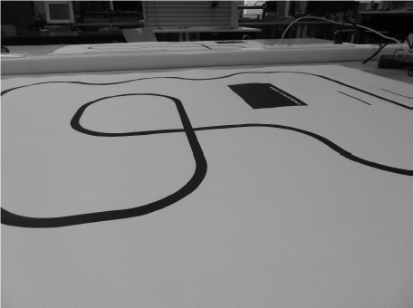

# LineFollower

lege repository die je als template kan gebruiken om een eigen repository te starten voor uw linefollower project

  
## specifications

microcontroller: Arduino Nano

motors: DC motor 300tpm, 6V

h-bridge: TB6612 DRV8833 DC Motor Driver Board Module Dual Motor Driver 1A

sensors: 	8 kanaals TCRT5000 IR Foto-elektrische Schakelaar

batteries: 	LiitoKala King4000 18650 4000mAh Battery - 2pcs

wireless communication: HC06 RF Draadloos Voor Bluetooth Transceiver Slave Module RS232/TTL

distance sensor - motors: 80mm

weight:

speed: 

